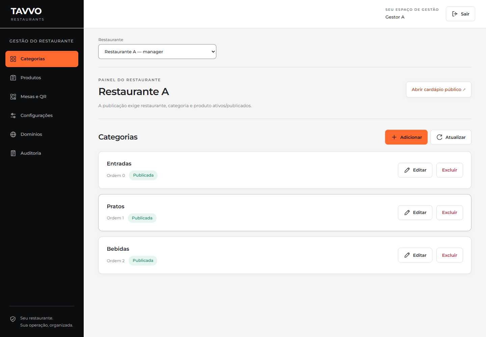
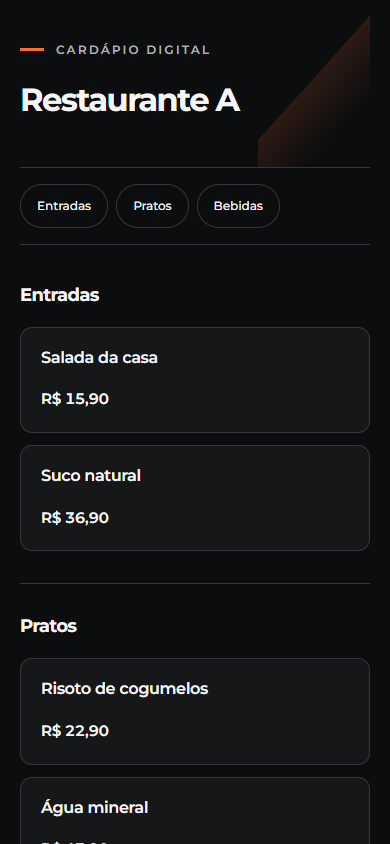

# Demonstração restaurada: Neon e Blob privado

Verificação concluída em 30/10/2026. Código publicado: `ffbcfcf`.

## Ambiente

- Projeto Vercel: `tavvo-demo`, ambiente preview, região São Paulo.
- Deployment: `dpl_CtygmDT9abc2uPam1Fi8GqPjyPxA`, estado Ready.
- URL: https://tavvo-demo-64ytdt0i3-eduardo-oliveiras-projects-9e8e2497.vercel.app
- Neon: `tavvo-demo-neon`, Free, recurso `store_6Z8pE4Af8IyWq01N`.
- Vercel Blob: `tavvo-demo-images`, privado, recurso `store_STqhuqIfdewY65AY`.
- Acesso compartilhado temporário guardado em `.local/acesso-demo.md`, com
  validade até 05/11/2026 às 23:18, horário de Brasília. Credenciais não entram no Git.

## Verificações

- 44 testes de backend passaram em 17,92 s; incluem quatro novos testes do Blob.
- Três testes E2E passaram contra o deployment em 21,6 s: gestor cria/publica
  cardápio, envia imagem, oculta publicação, testa isolamento, revoga QR e sai;
  cardápio móvel; administrador autenticado com MFA cria/inativa restaurante.
- Upload/leitura real do Blob funcionaram. Download direto sem autenticação
  retornou HTTP 403. O arquivo transitório de verificação foi removido.
- No banco remoto preenchido, `tavvo_app` vê zero produtos sem contexto; ao
  selecionar A ou B, vê apenas registros daquele restaurante. Há cinco produtos
  não arquivados em A e três em B. O contexto desaparece após a transação.
- Usuário de runtime sem superusuário/BYPASSRLS; sem DELETE na auditoria.
- `/health/`, `/ready/` e os dois endpoints de cardápio retornaram HTTP 200.
- Login, painel e cardápios preservam Montserrat e a identidade laranja/preta.
  Painel e cardápios em 390 px não têm overflow horizontal; zero erros de página.
- Revisão estática e dependências: Ruff, `git diff --check` e `pip check` passaram.
- O pacote de deploy exclui arquivos de `.local`, `.env`, `.agents` e `.git`.
  Entradas vazias de diretório no inventário não contêm arquivos sensíveis.

O teste local inicialmente não conseguiu conectar ao PostgreSQL por restrição
de rede do sandbox; a execução autorizada passou. O teste visual antigo exigia
um selo de rascunho inexistente nos novos dados. A verificação foi ajustada para
checar esse selo somente quando presente, preservando as demais verificações.

## Dados e limites

O Supabase suspenso recusou a exportação do banco e o acesso às imagens.
O recurso antigo foi preservado; **não houve importação dos registros antigos**.
Os dois restaurantes de demonstração foram recriados pela API. Os itens de
cardápio criados exclusivamente pelo E2E foram arquivados pela própria API.
O restaurante e a mesa de teste permanecem inativos, com trilha de auditoria.
A sessão administrativa usada nos testes foi revogada.

Nenhum plano pago foi contratado. Neon Free e Blob Hobby continuam sujeitos às
franquias gratuitas. Esta validação recupera a demonstração; não declara o
produto completo para lançamento comercial.

## Evidências visuais

