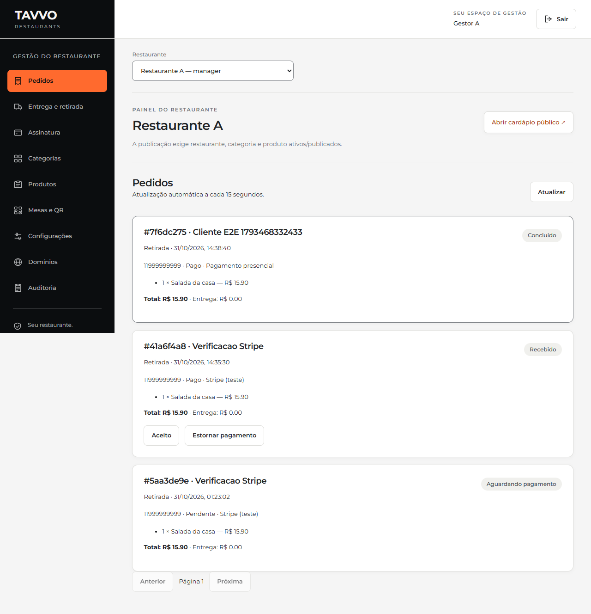
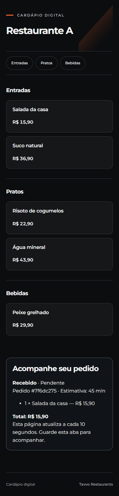
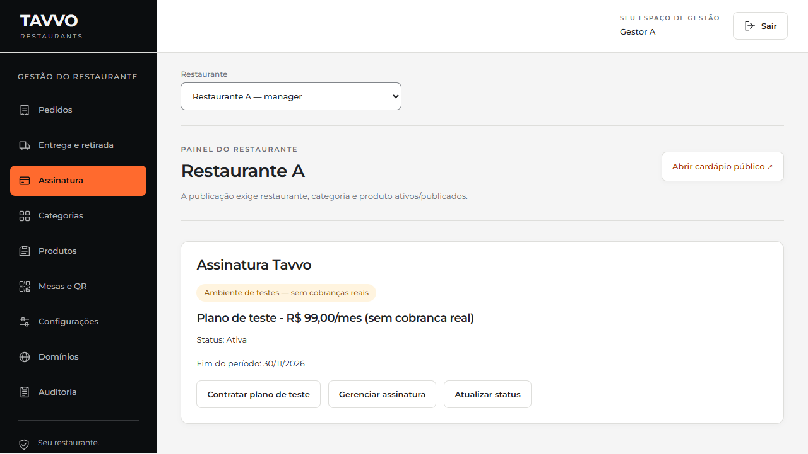

# Comércio de demonstração — 31/10/2026

Endereço fixo: https://tavvo-demo.vercel.app. Projeto `tavvo-demo`, equipe `eduardo-oliveiras-projects-9e8e2497`. Deployment final `dpl_2VHW8ERG7uompTbwzkWgbcK5UUM8`, Ready, código `007afac`. A configuração Vercel production serve a demonstração com `TAVVO_ENV=demo`, chaves Stripe de sandbox e e-mail automático desativado.

## Evidência executada

- 52 testes de backend passaram em PostgreSQL local isolado. Incluem cálculo de preço, idempotência, CEP, permissões, pagamento presencial, RLS, chaves compostas, assinatura de webhook, repetição de eventos, estorno fora de ordem, ciclo de assinatura e outbox de e-mail.
- Ruff e pip check passaram. OpenAPI validou com `--fail-on-warn`; tipos compartilhados, typecheck e builds React/Next passaram.
- E2E de pedido passou localmente em 23,0 s e no domínio público em 18,9 s: gestor abre pedidos, cliente usa viewport 390 px, pedido persiste após reload, gestor aceita/prepara/conclui, cliente recebe a atualização. Sem overflow horizontal ou erros de página nesse fluxo.
- Checkout de pedido criado pela API real, preenchido no navegador com cartão oficial de teste Stripe. O webhook real alterou `awaiting_payment/unpaid` para `received/paid`.
- Estorno solicitado pelo painel e executado no sandbox: pedido terminou `cancelled/refunded`.
- Assinatura fictícia de R$ 99,00/mês contratada pelo painel com cartão de teste. Webhook confirmou `active`; portal autenticado da Stripe abriu pelo painel.
- Consultas reais ao SDK também verificaram reaproveitamento idempotente de checkout de pedido e assinatura; sessões desse teste foram expiradas e a transação local revertida.
- No Neon, runtime sem contexto enxerga zero pedidos, itens ou assinaturas. Contexto A enxerga três pedidos e uma assinatura; contexto B, zero. Sem credencial administrativa no aplicativo publicado.
- `/`, `/health/`, `/ready/`, `/r/restaurante-a` e `/r/restaurante-b`: HTTP 200. `/v1/auth/me/` anônimo: HTTP 403.

## Correções encontradas durante a validação

O SDK Stripe 16 exige `to_dict()` para usar métodos de dicionário; os testes detectaram e cobriram a correção. A configuração Python de subscribers fez a Vercel priorizar `pyproject.toml`; dependências foram declaradas explicitamente para manter o build funcional. As escolhas do OpenAPI receberam nomes estáveis para eliminar avisos da CI.

O primeiro E2E remoto encontrou HTTP 400 no acesso interno do Next à API. O hostname do vínculo Vercel Services precisava estar em `DJANGO_ALLOWED_HOSTS`. A configuração final aceita o domínio fixo e o hostname interno exato do projeto; a tentativa com wildcard foi rejeitada pela revisão automática e substituída pela configuração restrita. O E2E remoto passou após a correção.

## Limites e decisões do proprietário

O responsável autorizou o link público fixo e escolheu deixar o Gmail para depois. A fila está implementada e testada localmente; entrega real por SMTP e execução cloud do consumidor não foram homologadas nem ativadas. Nenhum e-mail real foi enviado nesta etapa.

O sandbox Stripe ainda requer a ação **Claim sandbox** do proprietário, solicitada na conversa. A Vercel retornou `action_required` com um link de vinculação, mantido fora do Git. Não foi contratado plano pago nem ativado pagamento real. O estado de demonstração não declara prontidão para operação comercial; veja os requisitos de Connect, domínio e fiscal em `docs/commerce-demo.md`.

## Capturas

